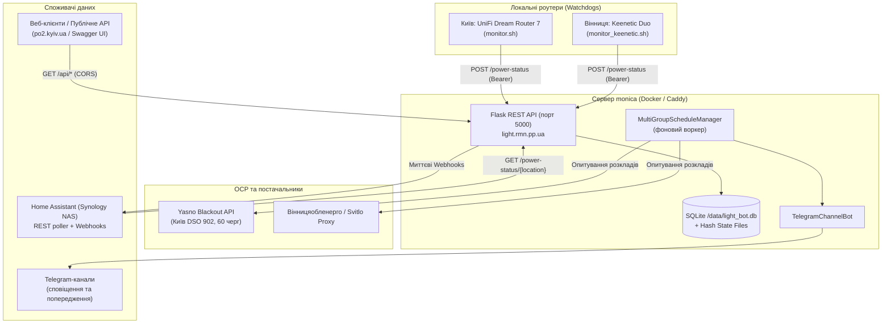

# Light Bot Skill

Цей скіл містить інженерні інструкції, архітектурний опис, регламент розгортання та правила діагностики для сервісу **Light Bot** — системи моніторингу наявності електроенергії, відстеження змін у графіках відключень Yasno / ВОЕ та сповіщень у Telegram і Home Assistant.

> [!IMPORTANT]
> **Публічний репозиторій**: Репозиторій `light-bot` є відкритим (open-source). Будь-які секрети (токени Telegram, API Bearer-токени, паролі, точні ідентифікатори приватних каналів, URL вебхуків Home Assistant) суворо заборонено комітити в репозиторій чи додавати до цього скіла. Усі облікові дані керуються виключно через локальні `.env` файли (додані до `.gitignore`) або зашифровані файли (`.enc`).

---

## 1. Архітектура та компоненти системи

Light Bot побудований за розподіленою клієнт-серверною моделлю:



### Основні сервіси та файли
- **Точка входу**: `main.py` — запускає веб-сервер Flask та фоновий планувальник розкладів.
- **REST API & Swagger**: `src/light_bot/core/api_blueprint.py` — публічне API, Swagger UI (`/api/docs`), специфікація OpenAPI 3.1 (`/api/openapi.json`) та `llms.txt`.
- **Сервер обробки статусів**: `src/light_bot/core/server.py` — ендпоінти прийому телеметрії від роутерів (`/power-status`), перевірка автентифікації та відправка вебхуків у Home Assistant.
- **Менеджер графіків**: `src/light_bot/services/multi_group_schedule_manager.py` — координатор per-group сендерів, відстеження змін у розкладах, попередження за 30 хв до відключення.
- **Клієнти постачальників**:
  - `src/light_bot/api/yasno/` — клієнт Yasno Blackout API (Київ DSO 902).
  - `src/light_bot/api/voe/` — клієнт Вінницяобленерго (VOE).
  - `src/light_bot/api/composite_client.py` — агрегація розкладів між різними провайдерами та містами.
- **Моделі конфігурацій**: `src/light_bot/models/group_config.py` — валідація, безпечні суфікси файлів та підтримка `group_dynamic`.

---

## 2. Публічне REST API (`https://light.rmn.pp.ua`)

Усі GET-ендпоінти у просторі `/api/` є публічними, підтримують CORS (зокрема для `po2.kyiv.ua`) і не вимагають токена авторизації.

| Метод | Ендпоінт | Опис |
|---|---|---|
| `GET` | `/health` | Базова перевірка працездатності контейнера |
| `GET` | `/api/docs` | Інтерактивний Swagger UI |
| `GET` | `/api/openapi.json` | Повна специфікація OpenAPI 3.1 |
| `GET` | `/api/llms.txt` | Машиночитний маніфест API для AI-агентів |
| `GET` | `/api/power-status` | Поточний стан електромережі за замовчуванням (Київ / home) |
| `GET` | `/api/power-status/<location_id>` | Стан електромережі для локації (`home` або `vinnytsia`) |
| `GET` | `/api/locations` | Список усіх активних локацій з їхнім статусом та часом |
| `GET` | `/api/events?limit=50&location=home` | Історія переходів (увімкнено/вимкнено) та тривалість |
| `GET` | `/api/history?days=30` | Добова агрегована статистика (тривалість відключень у секундах) |
| `GET` | `/api/stats` | Метрики доступності електроенергії (uptime %) |
| `GET` | `/api/schedule` | Актуальний графік відключень на сьогодні та завтра |
| `POST` | `/power-status` | Прийом статусу від роутерів (`Authorization: Bearer <TOKEN>`) |

---

## 3. Специфіка графіків Yasno та система 60 черг у Києві

### Як організовані групи в Yasno
1. **API розкладу**:
   ```text
   GET https://app.yasno.ua/api/blackout-service/public/shutdowns/regions/25/dsos/902/planned-outages
   ```
   У відповіді повертається JSON-словник рівно на **60 черг**: від `'1.1'` до `'60.1'`.
   Формат ключа: `N.1`, де $N \in [1..60]$ — номер черги, а `.1` — це підчерга 1.

2. **Визначення групи за адресою будинку**:
   - Пошук вулиці:
     ```text
     GET https://app.yasno.ua/api/blackout-service/public/shutdowns/addresses/v2/streets?regionId=25&dsoId=902&query=<НАЗВА>
     ```
   - Пошук будинку:
     ```text
     GET https://app.yasno.ua/api/blackout-service/public/shutdowns/addresses/v2/houses?regionId=25&cityId=&streetId=<STREET_ID>&dsoId=902&query=<НОМЕР>
     ```
   - Отримання групи:
     ```text
     GET https://app.yasno.ua/api/blackout-service/public/shutdowns/addresses/v2/group?regionId=25&dsoId=902&streetId=<STREET_ID>&houseId=<HOUSE_ID>
     ```
     Повертає: `{"group": 53, "subgroup": 1}`.

3. **Статичне vs Динамічне налаштування в Light Bot**:
   - **Статичне**: в змінній `YASNO_GROUPS` задається конкретний рядок:
     ```json
     {"id": "home", "group": "53.1", "city": "kiev", "channel": "@my_channel"}
     ```
   - **Динамічне (`group_dynamic`)**: бот сам періодично опитує адресу Yasno:
     ```json
     {"id": "home", "group_dynamic": "https://app.yasno.ua/api/blackout-service/public/shutdowns/addresses/v2/group?regionId=25&streetId=175&houseId=7999&dsoId=902", "city": "kiev"}
     ```
     Бот резолвить `{"group": 53, "subgroup": 1}` у `"53.1"` і оновлює моніторинг без перезапуску.
     Інтервал резолву: `GROUP_RESOLUTION_INTERVAL=21600` (за замовчуванням кожні 6 годин).

---

## 4. Інтеграція з Home Assistant (Zero-Latency Webhooks)

Для усунення затримок опитування Home Assistant інтегрований у два способи:
1. **Миттєві Webhooks при зміні стану**:
   При переході світла `on` $\leftrightarrow$ `off` сервер надсилає POST на захищений вебхук Home Assistant:
   - `HA_WEBHOOK_URL_KYIV` — вебхук для Києва.
   - `HA_WEBHOOK_URL_VINNYTSIA` — вебхук для Вінниці.
   > [!WARNING]
   > **Правило ізоляції вебхуків**: Кожна локація зобов'язана мати свій унікальний webhook ID. Заборонено спрямовувати декілька локацій на один вебхук, щоб уникнути взаємного затирання стану в Home Assistant.

2. **Резервний REST Poller у Home Assistant**:
   HA періодично опитує `https://light.rmn.pp.ua/power-status/home` сенсором `binary_sensor.svitlo_v_oseli_light_bot` (клас `power`).

---

## 5. Розгортання та експлуатація на VPS `monica`

Light Bot розгорнутий на VPS `monica` у складі загального Docker Compose стека `/root/services`:

```bash
# Перехід до каталогу сервісів
cd /root/services

# Збірка та перезапуск контейнера light-bot
docker compose --profile prod-public up -d --build light-bot

# Перегляд логів
docker logs light-bot --tail 100 -f
```

### Критичні правила розгортання:
1. **Мережа `services_default`**: Контейнер `light-bot` повинен бути підключений до спільної мережі Docker Compose, щоб Caddy міг проксіювати запити з `https://light.rmn.pp.ua` на внутрішній порт `light-bot:5000`.
2. **Томи даних (Data Mount)**: Обов'язково монтується `/root/services/light-bot/data:/data`. Там зберігаються база `light_bot.db`, хеш-файли розкладів та watchdog-файли. Без цього при перезапуску втрачається історія та виникає спам повторними сповіщеннями в Telegram.
3. **Заборона ізольованого запуску**: Ніколи не виконувати `docker compose up -d` виключно всередині `/root/services/light-bot/` без контексту кореневого compose — це створить відокремлену мережу `light-bot_default`, що призведе до `502 Bad Gateway` у Caddy.

---

## 6. Тестування та діагностика

```bash
# Запуск юніт-тестів у репозиторії
pytest tests/ -v

# Тестування публічного API blueprint та Swagger
pytest tests/test_api_blueprint.py -v

# Перевірка живого стану через CLI
curl -s https://light.rmn.pp.ua/api/power-status | jq .

# Перевірка підключених локацій
curl -s https://light.rmn.pp.ua/api/locations | jq .
```
